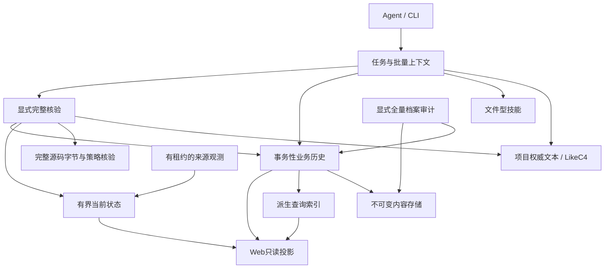

# HarnessL3 运行架构重设计规格（v0.57）

- 日期：2026-11-26
- 状态：**本机真实落地、迁移和用户确认的当前Windows实测基准已收尾，GitHub原生三平台功能/安装门禁已通过**。完整24小时仍延期，不标为已通过；已提交推送，未发布npm，实际结果以STATUS为准。
- 决策来源：2026-11-26 现场存储与模块复盘；用户明确同意按方案落地执行，并要求先保存 Spec。
- 范围：本机运行状态、任务/批次/验证历史、来源观测、存储迁移、服务资源生命周期、CLI/Web 投影及发布质量。项目基准 D01–D15 中与本方案无关的决策保持；本方案明确修订 D06–D09、D12、D14 的运行数据边界及性能验收。旧0.1.8松散格式为事故基线/兼容依据；本机已验证并安装同包版本的新运行指纹，其他安装或正式发布不作外推。
- 实施与验收结果的唯一登记入口为 [STATUS.md](STATUS.md)；当前产品契约入口为 [工作规格](../spec/README.md)，原格式与旧数据兼容约束见 [storage.md](../spec/storage.md)。

## 1. 事故基线与确认的根因

现场数据根为 `%LOCALAPPDATA%/HarnessL3`。`worktrees/<UUID>` 是本机运行档案，不是源码检出。2026-11-26 读取文件逻辑长度（不是NTFS实际分配空间或累计物理写入量），共25个登记工作区（22 Git、3普通目录）。未遍历未知外部用户文件，也未删除原档案。统计时服务仍运行，数值为该次盘点近似口径。

| 内容 | 实测 |
| --- | ---: |
| 总档案 | 290.384 GiB |
| snapshots | 284.387 GiB，约97.9%，约1,253,460个文件 |
| journal | 3.495 GiB |
| SQLite | 2.467 GiB |
| tasks | 0.033 GiB |
| browse-index | 约0.002 GiB |
| skill-blobs | 约0.001 GiB |

最大工作区 `ai_mana_front` 有148,745个快照、64.318 GiB；随机100个均为freshness receipt，文件大小中位约452.65 KiB，待核验路径中位8,007，`pendingPaths` 约占样本字节的99.34%。其149,010条日志中有148,935条 `freshness-state`，其中124,670条 `observed-after-commit`。Joi bugfix 工作区有343,662条 `freshness-state`，其中338,001条 `observed-after-commit`；抽样代次最高约2.603亿。五个最大工作区快照合计约245 GiB。抽样不代表每个快照均为该类，不能据此估算可直接删除的精确字节。

实机复现：已安装0.1.8的 `FreshnessManager` + `Archive` 隔离夹具，预置8,000条pending路径，对同一条已pending路径注入10次通知。在路径集合不变时，仍生成10次提交、10个快照、3,846,411字节。正式回归用例 `TC28 repeated notifications never append full synchronization history` 已对旧实现实际运行失败（10次提交，期望0）。该用例用于锁定问题，不是修复后的通过证据。

实际 `task start` 默认snapshot模式：在30秒超时前重放283,121,084字节journal，进入45,277条历史提交的归档核验；原requestId查询证明服务最终完成，未盲重发。说明当前新任务入口与无关历史恢复存在规模耦合。

已确认的设计缺陷：

1. `freshness.ts` 将普通原生通知、增量观测及后台状态变化视为永久业务提交；完整pending路径集合随代次变化重复序列化，内容寻址无法去重，提交窗口内的变化还会触发后续提交。
2. `archive.ts` 对每次提交写独立回执、追加并同步日志、重写派生浏览索引；单个低价值事件的磁盘和CPU成本随当前状态大小、历史规模增长。
3. 完整历史核验阻塞新任务；索引及恢复对大量无价值事件支付重复成本。读写优化不能补救错误的数据价值分类。
4. 已激活工作区长期监听、周期全扫、缺乏资源租约和事件/容量预算；事件风暴时缺少有界退化机制。
5. Context累积任务/批次/回执存在重复保存，尚未测得此项在现场总空间中的独立贡献。观察日志、目录扫描、Web刷新与服务调度亦需按下述契约检查相应成本。

**尚未确认**：具体原生通知风暴的触发路径、工具或平台来源；累计物理写入量、磁盘分配开销及历史可压缩/迁移后的确切空间。不得将这些未测项当作已证实因果；以隔离的源事件采样、真实工作负载及前后对照补证。

## 2. 目标与非目标

目标：按数据价值、生命周期、可靠性分层，而不是无限保存运行事件。通常工作的成本应与当前模型、所选内容、实际变化和本次任务大小相关，不能与机器上无关历史的总量成线性关系。保留严格来源核验和任务历史可追溯性；不通过减少真实业务记录或假报verified获得性能。

非目标：重做LikeC4主模型、技能选择逻辑、脑图产品设计、工作区身份或改成自动Agent/Hooks系统。保留现有CLI入口、公共语义、原requestId、60天默认发现窗口及已知任务归档可读。无用户明确范围不执行永久历史purge；不把源码、技能库或普通用户文件当运行缓存。

## 3. 目标架构与数据权威

| 数据 | 权威/用途 | 生命周期与访问 |
| --- | --- | --- |
| 项目模型、配置、知识、证据、别名 | 项目真实文件 | 随源码保留；Git/普通目录边界不变 |
| 用户技能及附件 | 实际可编辑文件（含活动junction实体） | 不由存储迁移、缓存或GC覆盖 |
| 注册、当前同步状态、运行游标、租约 | 单写本机事务状态，目标为SQLite | 有界、按目标原子更新；活动态与业务历史分离 |
| 任务、所选目录与技能、实际返回、验证声明、错误及原始可重放回执 | 事务性业务历史 | 保留可重放的原始归属、ID、时间、版本、正文与引用；增量提交 |
| 不可变模型、技能、必要来源/依据与协议字节 | 内容寻址的不可变存储；紧凑、压缩、可跨工作区共享内容 | 原字节和原哈希可验证；共享内容不共享工作区状态/权限/归属；引用闭包决定存活 |
| 原生watch通知、后台待核验计算 | 内存/有界当前态，必要的持久失效标记 | 不是永久业务历史；合并、限流、空闲释放 |
| 查询、布局、浏览定位、搜索索引 | 可重建派生物 | 不成为第二份权威；不随Agent任务永久增长大量重复数据 |

目标采用本机SQLite事务存储运行状态及业务记录，并以版本化内容存储保留不可变原字节；SQLite内部的搜索索引仍为派生，不从数据库编辑项目知识。旧格式先兼容，逐阶段切换，不要求一项改动同时替换全部存储。每类数据只有一个写入权威，旧格式与新格式不能形成双写分歧或隐式覆盖。明确版本、事务边界、单实例所有者、错误及回退；旧程序不能打开已切换的新运行格式继续写入。Node.js/TS/npm、本机三平台、可重建投影保留。

## 4. 功能与不变量

### R01：运行状态与历史分离（P0）

- 普通后台原生通知不得创建不可变完整状态快照、业务Journal行或搜索索引记录；当前pending、观测信息及必要失效标记通过独立有界状态更新。即时内存失效和有限频率的持久状态更新分离，允许合并但不丢失保守核验义务。
- `pendingPaths` 按集合更新；同一已pending路径的重复通知不复制全量集合。未知覆盖/目录/规则变化使用明确的全局待核验范围（可分批解析实际文件），不制造大量路径级历史；有限范围proof不能清除未核验的其它范围。
- 代次/失效令牌必须继续区分真实源变化、模型/策略变化、观察缺口与字节回退；不因去重或合并而允许旧proof。令牌持久化以核验依据的有效性和已返回的绑定为边界；退出/崩溃/租约结束及覆盖失效后，之前的未提交声明保守失效，重新完整核验，不能因原字节恢复而沿用旧声明。
- 只有实际业务操作（任务、批次、技能读取回执、显式验证结果、显式订阅的有意义观察等）及必要语义变更进入历史。显式status读取是当前核验状态的取得，不要求每次永久保存完整状态；迁移期可先保留有界显式检查记录，最终由当前状态负责。原legacy状态历史不自动清除/猜写。
- 当前状态损坏/不可持久化返回诊断及unknown/pending；原任务历史仍可按独立完整范围读取，不能因状态错误声明通过。

### R02：按需观测、扫描和资源预算（P0）

| 模式 | 进入/退出 | 允许的工作 |
| --- | --- | --- |
| Passive（默认） | 登记、冷启动、普通归档浏览、租约到期 | 不主动来源全扫，不启动持续源码轮询；当前来源未知或保守pending |
| Active | 真实进行中的工作/显式同步操作取得有界租约 | 失效通知、合并路径、必要增量观测；同一路径的频繁通知合并计算；不周期完整扫所有工作区 |
| Verify | 显式verified绑定、sync status/verify | 严格原字节及来源策略/模型检查，必要双遍与CAS、有界竞态恢复；完整验证不得以mtime或增量观测替代 |

租约须按真实用例续期；空闲、路径消失、工作区停用、覆盖错误及服务停止及时释放订阅和资源。显式日志订阅是独立生命周期，保留两种真实宿主日志的读-only事实；未绑定不进行无意义高频轮询。后台有并发、排队、路径分类、批次、重试和内存预算，超出时合并、降级为unknown/pending并提示显式验证。前台优先且独立工作区公平，不能把全局串行队列内的大量后台工作放在交互请求之前。

### R03：独立普通任务与完整档案审计（P0）

- 默认snapshot任务只捕获当前有效模型/技能目录、必要当前身份及事务状态；sourceVersion=unknown、sourceScanRevision=null。不得读取全部无关历史正文/快照，也不得核验全部旧同步回执。
- 显式历史内容读取只核对所请求记录、事务凭据和引用闭包；未请求的工作区完整性必须保持unknown。历史损坏与当前可用性区分，明确记录不可验证范围；不得凭损坏派生索引伪造历史。
- 显式全量历史审计/迁移完整性验证是独立的可暂停/进度可见的用例，保留日志链、原字节、任务与回执归属、引用闭包及状态代次检查，不强制普通RPC先执行。旧日志结构初次验证/索引建立的成本单列，不能用缓存或缩短校验范围冒充workspace已全检；目标运行格式必须让百万历史的普通新任务不依赖全量重放。
- 明确操作级完整性（当前事务/请求范围/完整档案）；所有未知写结果先核对原requestId，重放原回执而不补造内容。

### R04：业务历史与内容存储（P1）

- 任务元数据、模型/目录版本引用、逐批实际结果、技能方案与文件读取回执分别记录；当前物化任务/累计packet通过已提交批次构建，不每次重复储存全部前序任务。历史批次边界、原catalog/group/ID、原字节及返回内容继续可精确重建。
- 同样内容跨任务/工作区可共享不可变字节，必须核对内容指纹、类型、完整性和真实引用；版本、身份、当前来源、技能选择及权限不得合并。更小的回执记录不改变CLI既有默认输出及compact恢复契约。
- 业务事务先保证必要内容可持久读取，再提交请求ID与结果引用；崩溃后只从已提交事实恢复；单写，幂等冲突规则、已持久但响应丢失及partial保持。
- 不可变内容以可验证的紧凑容器/块存储而非百万孤立小文件为目标，压缩可无损还原原始字节及哈希。索引不保存重复正文、无意义watch事件或完整当前状态，将完整扫描、校验、查询成本分开计量。

### R05：CLI、Web与Service（P1）

- 保持CLI发现、入口、requestId、JSON封套、退出码、stderr进度、权限/目标校验和24小时链接机制。旧版命令/回执兼容；新增审计/迁移/诊断入口须在CLI契约及Schema中冻结后实施。
- Web普通浏览保持只读且不续期。当前状态变化是可合并的临时更新，不借业务提交序号制造虚假历史事件；历史批次仍基于已提交数据。分页、当前/历史区别、实时刷新合并与缓存失效受独立预算约束。
- 服务常驻单实例不等于常驻全部工作区监听/索引/模型。可观测指标至少包括活动工作区、观察覆盖、排队/在途、读写字节/次数、快照数、数据根容量及增长、冷/热请求耗时、内存和健康状态；指标有界且不能反向造成日志膨胀。低空间、写失败、事件放大时停止非必要持久化并保守pending，优先保护已提交业务历史和可恢复性。

### R06：原档案无损迁移与容量回收（P1）

现场290 GiB原数据含真实业务记录、旧后台状态及可能未引用内容，不能按目录名或抽样比例直接删除。迁移是明确、可重复执行的操作，不在普通升级、列表、查看、任务或注册时隐式触发。要求如下：

1. **止写及清单**：正常排空原服务并确认单写锁；核对目标、版本、全部工作区原UUID、源文件规格/字节、日志链、引用与异常；按真实类型统计业务历史、后台状态、派生索引、未知及可能孤立文件。不删除或修改源。可重建缓存与权威历史明确分层。
2. **目标与空间**：选择用户确认的足够空间的本机独立临时目标/数据根，核对真实绝对路径、卷空间、所有者及与源码/数据根的不重叠；不能在C盘额外产生完整290 GiB复制；不自动移动凭证、改ACL、创建Git或切换项目。保留完全可回退的机器配置、端口关联、技能入口/实体及原数据。
3. **版本化复制转换**：流式、可断点、独立阶段的manifest及原字节哈希；将旧原始历史按类型压缩归档并保留原引用、时间、ID、请求及原hash，必要时提供兼容解码器。当前运行状态从最近实际记录恢复后标记待核验，来源unknown不填造。历史噪声无需进入新活跃业务索引，但原数据仍在可验证的归档内，旧审计可访问。
4. **全量核对**：逐工作区验证源/目标引用闭包、原始内容哈希、任务/批次/模型/技能/原receipt及legacy兼容、60天边界、失败结果和明确损坏项；旧格式原hash和新封套hash分别保存。任选实际历史回放仅作为补充，不能替代全量迁移校验。运行中变化、数据不足、磁盘满、中断和损坏必须停止相应切换，不重新执行历史命令。
5. **切换及回退**：只有已核验目标通过且原写者停止，才以原子可恢复的版本/数据根切换启用新运行格式，核对实际服务构建。原数据保持可回退，旧程序不能写入新格式。重新验证实际CLI/Web历史、新任务、同步及权限，报告迁移后的实测总空间/文件数/读写性能。任何尚未核对部分保留未完成。
6. **回收旧副本**：只有迁移完整性核验和回退安排均得到确认，并有对具体旧副本的明确删除/回收授权，才移除经过清单确认的重复物理副本。此步骤不授权永久purge、不删未知用途文件、不跟随越界链接、不删真实技能实体或源码；不把派生索引成功当成权威历史仍完整的证明。

用户已确认本机目标`I:\HarnessL3-data`；实际dry-run核对空间、源与目标无重叠，结果见STATUS。精确空间降幅、最终完整性和切换时段仍待实际转换验证；旧服务draining状态不能视为已停。新运行格式不依赖旧噪声数据常驻活跃索引。

## 5. 模块责任与质量审查

| 模块 | 审查结论与目标责任 | 对应要求 |
| --- | --- | --- |
| `freshness` | P0：当前同步态、失效/覆盖、显式核验；去除高频归档耦合 | R01/R02 |
| `source` | P0：精确来源适配，调用由明确模式决定；严格检查不减弱 | R02 |
| `archive`/持久化 | P0/P1：当前状态、业务事务、不可变内容和历史审计分开；保护旧读取 | R01/R03/R04/R06 |
| `runtime` | P0：将当前任务用例与旧历史恢复、被动工作区资源隔离 | R02/R03 |
| `context` | P1：任务增量、选择、原始返回及幂等；避免累积记录复制 | R03/R04 |
| `index`/`index-worker` | P1：可重建查询、紧凑定位；不重复正文/噪声事件 | R04/R05 |
| `observation` | P1：真实显式日志绑定、按需/有界轮询，记录有意义事实 | R02/R05 |
| `model`/`references`/`model-maintenance` | 核心保留：文本权威、身份、证据；解析与核验分层，按需取得 | R02/R03 |
| `skills`/`catalog` | 核心保留：实际目录、冻结所选字节；扫描、缓存和资源有界 | R03/R04 |
| `workspace` | 核心保留：登记与真实身份/路径隔离，独立工作区状态 | R01/R06 |
| `cli`/`controller` | 保留外部契约，避免普通请求承担后台历史全量工作 | R03/R05 |
| `service`/Web | 单实例、可观测、生命周期与流控；只读历史和实时状态分开 | R02/R05 |
| `maintenance` | P1：显式迁移、审计、回收及旧格式兼容；无隐式删除 | R06 |

## 6. 实施顺序与阶段退出条件

| 阶段 | 工作 | 退出条件 | 当前状态 |
| --- | --- | --- | --- |
| S0 事故基线/规格 | 现场盘点、隔离复现、记录证据、正常停止问题服务或控制风险 | 审计可复查、用户确认方向、保护既有数据；停止与在途状态按实报告 | 盘点/复现/方向已确认；旧实现回归失败；原服务已实际正常停止 |
| S1 紧急止血 | R01、R02；取消后台全态历史提交、按需租约/扫描、事件风暴及崩溃安全 | TC28/TC29/TC30；无后台写放大，CAS/旧回执保持 | 实际Windows/Linux完整回归通过；Windows25工作区563次/9小时27分13秒被动观察零增长，按用户选择本轮收尾，完整24h延期 |
| S2 新任务解耦 | R03；操作级验证、旧格式读取、独立全量审计，优先新任务和已知任务读取 | TC31；新任务与无关历史正文规模解耦，损坏范围可见 | 最新候选隔离损坏/取消、混合百万旧状态元数据普通任务及710秒完整只读审计均实跑通过 |
| S3 事务与存储 | R04/R05；增量任务、当前态事务、内容紧凑存储、索引/调度/Web | TC32/TC33；原回执、真实读取、资源预算及故障恢复通过 | 候选及25工作区长任务专项、Windows浏览器/隔离包门禁通过 |
| S4 迁移 | R06；隔离迁移夹具、只读现场清单、实际无损复制转换/验证/切换 | TC34；原字节、全部引用与实际服务验证，报告可回收空间与回退 | 通过：25工作区真实转换、原内容/日志/身份/技能与原任务核对、I盘全局切换、新旧任务/Web、用户明确授权后的C盘重复物理副本回收及兼容junction复核；实际C卷回收窗口增加293.9 GiB |
| S5 发布质量 | 长时/多规模/三平台、实际宿主、安装更新、完整回归 | TC35及受影响既有TC；记录实测成本与实际未通过场景；不先删原历史 | 本轮用户确认的当前Windows范围完成：451项零失败、真实安装/迁移Web/包消费通过、9小时27分13秒连续稳定并归档清理；Linux补充实测及7a3d2f5 GitHub原生三平台完整程序/Web/安装包门禁通过，完整24h和发布延期 |

每阶段先失败测试/测量→实现→重跑→检查关联模型与证据→更新实际状态。已获授权范围无需重复确认；重大设计偏离或真实不可逆旧副本处置按原授权边界处理。产品工作区变更依照 AGENTS 同阶段维护知识和当前模型；计划必须标成计划。可独立交付止血版本，不能把它称为完整S1–S5通过。

## 7. 验收矩阵

验证范围扩充 A10/FR14，涉及FR01/03–07/09–12/14/15；保留 [原有TC](../spec/acceptance.md) 的身份隔离、迁移、60天、权限、CAS、崩溃、回执等语义。在固定隔离夹具明确测量逻辑文件字节、实测预/后磁盘空间、文件创建数、读写字节/次数、事件/提交数、CPU/内存、前台P50/P95、冷恢复、热查询。真实档案及合成夹具报告分开。硬件相关绝对时延/容量预算在实际基线测量后确定，不凭任意毫秒门槛或跳过核验宣称通过。

| 用例 | 情景 | 可执行退出判据 |
| --- | --- | --- |
| TC28 | 8,000个pending路径，10/10,000次同路径通知；真实连续编辑、构建、忽略目录和事件风暴 | 重复后台通知不新增完整不可变状态、业务提交或噪声索引；合并状态不丢有效待核验信息，内存/分类/写入工作有界；对实际改动/回退保守失效；记录前后字节和次数 |
| TC29 | 25个已登记、无活动工作区，连续24小时；活动工作区租约到期、目录删除/恢复、覆盖失败 | 被动工作区不持续源码全扫或写业务档案；停止后无活动watch/poll资源，恢复需真实核验；有明确观测范围和unknown/pending；不能通过禁用所有显式订阅规避 |
| TC30 | status、verify与连续通知交错；原配置恢复、模型/策略变化、回退、重启、落盘失败 | 严格原字节/模型/策略/失效CAS，旧proof拒绝；新声明经过真实重新审核；显式失败/成功原回执可查，局部核验不清其它pending；失效/故障不能报告verified |
| TC31 | 百万条旧背景状态及实际任务混合历史，冷/热task start/select/handoff，损坏无关/目标记录，显式全量审计 | 默认snapshot不读取无关历史正文；目标引用严格检查，未请求完整性unknown；新格式任务入场不依赖全历史重放；全量审计可独立查出旧损坏，不伪报整个档案完整；同时记录日志结构冷载成本 |
| TC32 | 多阶段、长任务与重复模型/技能跨25工作区，增量与历史回放；中断事务/回执 | 不重复保存累计前序任务，逻辑增长与实际新增内容/记录相关；原任务及各批次内容、原requestId回放、哈希/归属、60天和partial保持；损坏/磁盘满不产生未提交成功 |
| TC33 | 两个以上同时活动工作区、跨项目Web、事件流/日志订阅、低磁盘与高负载 | 资源队列、读取、写入、事件和内存有界；前台可用、工作区公平；Web不创建任务/读取/续期，不以临时状态充当业务事件；当前态与历史隔离；报告成本和降级 |
| TC34 | 合成旧格式完整/缺失/损坏/超期/中断夹具；实际25工作区无损迁移 | 清单、源/目标独立验证、旧字节/hash和引用闭包、ID/时间不变、旧任务可回放；重试/回退/原服务状态可证明；无不明处置；实际迁移容量与剩余空间明确 |
| TC35 | Windows/macOS/Linux独立长时和故障注入；真实安装、更新与宿主入口 | 每平台实际运行受影响用例；记录24小时被动、构建和多工作区、百万历史负载的测量；实际构建/服务/CLI/Web与数据归属经核对；未测范围不得标passed |

既有验收关联：TC01/02（身份/隔离）、TC07/08（来源/epoch/声明）、TC13/16/17（恢复/历史/性能）、TC18/19（回执/技能）、TC21/22/23（Web/CLI/服务）、TC26/27（安装及真实宿主）。用例新增不改变源数据读取授权，不以三平台编译或单机通过代替完整长时验收。

## 8. 实施记录规则

每项阶段记录至少写明：实现版本及源码/构建指纹、真实命令及退出码、运行平台、被测规模、容量与读写成本、核验范围、历史字节/引用检查、实际失败及尚未运行项。用户关心的是实际使用成本，不是测试数量或压缩算法名称。以 [实施状态](STATUS.md) 和可复查工件报告真实结果，避免因每次状态更新重新写入本机任务历史。未实现的存储格式、尚未迁移的数据及未测性能在文档与界面中保持诚实区分。

用户补充工件放置约定：正常运行只使用已解析的本机数据根（项目权威文件仍在项目内），不会为每次任务或后台观测在卷根创建迁移/验收目录。迁移和验证是显式操作，工件须放入明确指定的非卷根本机目录，与生产根及用户源码隔离；用户显式生产数据根不因此改变。保留已核验的最终报告、哈希及真实回退所需原字节，再回收已停止、可再生的隔离夹具；运行中的夹具不搬动，结束后归档。具体本机位置见STATUS。
