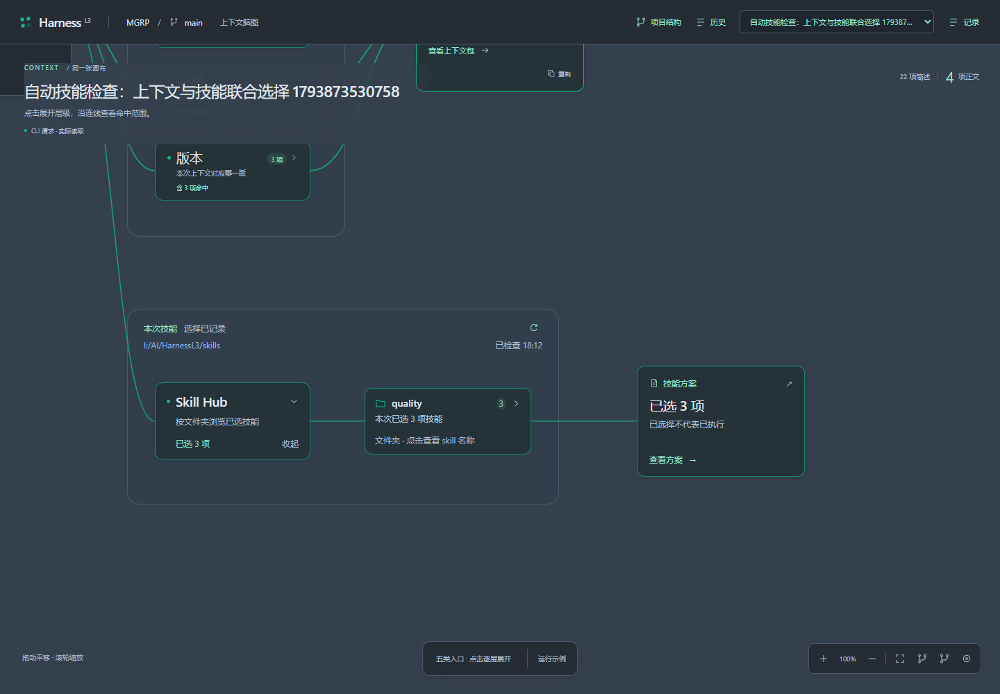
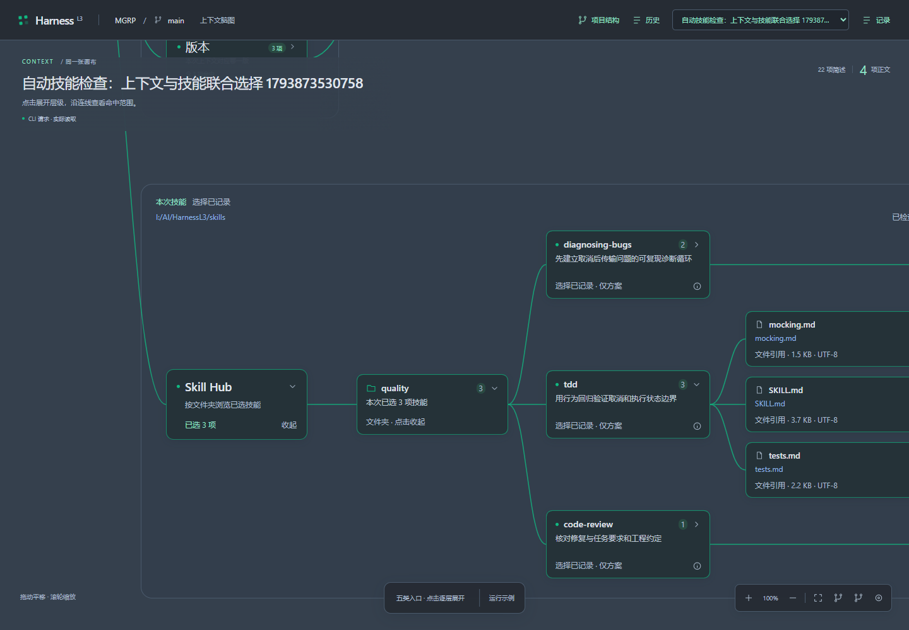
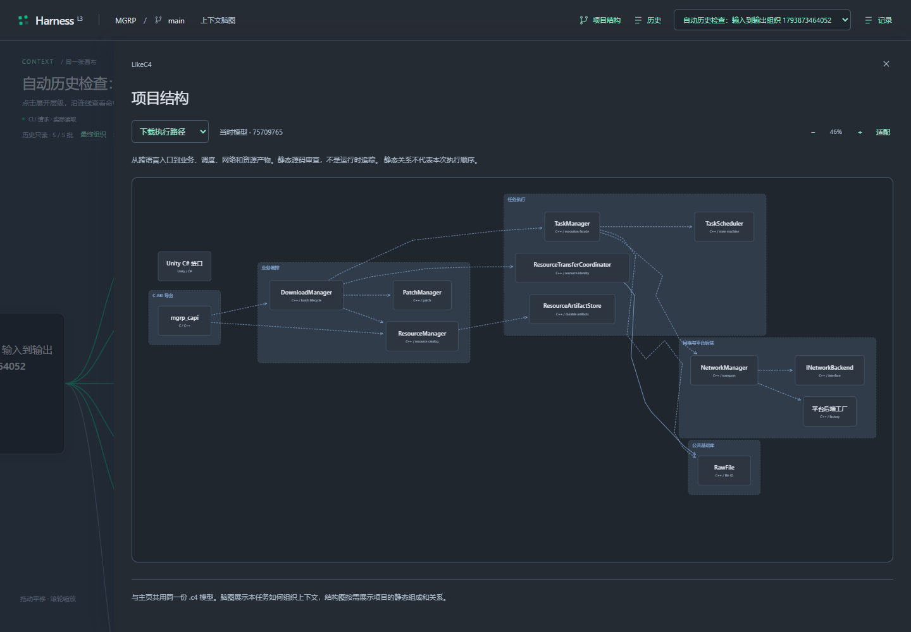
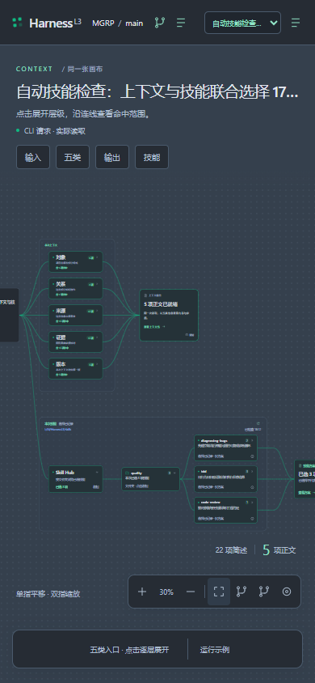

# 最终交互与视觉基准

版本v0.16，2026-11-05用户确认。后续实现只对接正式契约，不重新开放A/B/C/D选版。产品行为约束见[正式规格](https://github.com/LChJo/HarnessL3/blob/bfa3dd7/docs/spec/product.md)，此处维护展示细节。

## 同一张无限画布

任务输入、中央上下文、上下文输出和下方技能区都属于同一世界坐标，整体拖动/缩放；输入输出不固定在屏幕边缘。中间是一整块上下文区域，不按固定六站或串行任务流程拆分。独立目标可同时点亮，时间相邻和静态连线不构成调用因果。

初始显示对象、关系、来源、证据、版本五个一级模块；点击才展开下一层。展开保持点击节点的屏幕位置，收起父层隐藏后代，任务/事件/目录更新不自动打开子层。“概览”涵盖全部可见节点，定位按钮移动视口但不读取正文。手机支持单指平移、双指缩放，详情以可读抽屉显示。

五类只是同一权威上下文和返回包的投影。对象正文、直接关系、来源声明、证据引用与版本分别表达；来源和证据可追溯，推断与未核验状态可见。父层只汇总命中；各类计数不能累加为独立正文数。证据引用返回不等于源码片段已经读取。

## 下方 Skill Hub

`同一输入 → Skill Hub → 实际文件夹 → skill名称 → 文件引用 → 技能方案`，使用与上方一致的连线脑图和手势。技能与项目知识的选择原理不同，不混入五类或C4。

- 默认只显示Hub与方案。打开Hub只出现文件夹，打开文件夹才出现skill，再打开skill显示文件引用；详情入口独立。
- 未选时浏览实际目录，文件夹显示条目数；已选时只组织本次集合并聚合所选数量和点亮，不意味着整个类别被读取或执行。
- 文件夹来自实际group，不维护固定7类表；当前随包库是7类/20方法。目录增删改和手动刷新更新当前目录，不覆盖历史或已选方案。
- 历史按当时group/ID恢复，缺字段时只依据原ID定位，否则明确“未记录文件夹”。不把旧engineering自动改成现在的quality。
- 选择、文件返回与执行分开显示；浏览展开不产生agent读取或执行记录。

## 历史与C4

历史保留60天内的任务输入、批次组织、真实返回、技能方案与当时文件。查看历史或展开图不续期。历史打开后不被新SSE结果改写；用户显式刷新最终组织才加载后续批次。缺少记录不能用当前模型/技能补造。

C4从顶部“项目结构”或对象/关系详情按需打开，展示同一LikeC4模型的静态职责与关系；历史使用当时布局。脑图是上下文组织投影，不把技能建成C4对象。未使用Codux共享黑板或其它白板数据库保存产品任务。

## Slate配色

画布`#35404d`、卡片`#252b33`、主要文本`#e0e6ed`、点亮`#10b981`；候选/引用蓝`#8fb5e7`、错误红`#ef8a92`、警告暖黄`#e2c27f`。语义色板在原型src/theme.css，正式实现保持相同语义入口；不能用颜色替代状态文字。

主页面保持状态总览的清爽感；技术依据、原文、选择理由和失败细节按需进入详情，不把主页面做成技术架构介绍网站。手机概览允许缩放与平移，不能把整图缩小后的截图当作正文可读性验收。

