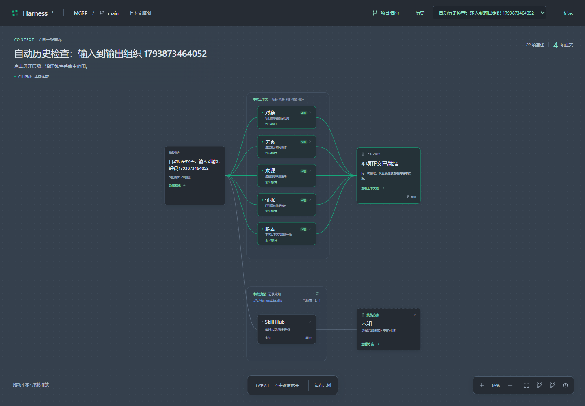

# 已确认的原型 v0.16

2026-11-05，用户已将此方案确认作为最终设计基准。此目录是正式实现的设计与历史依据；正式需求和接口从[工作规格](https://github.com/LChJo/HarnessL3/blob/bfa3dd7/docs/spec/README.md)进入，当前目标仍以[项目基准](../PROJECT_BASELINE.md)为准。

- [最终交互与视觉](DESIGN.md)：五类上下文、Skill Hub文件夹层、统一无限画布和Slate。
- [历史复现资料](RUNNING.md)：原型参考命令及机器配置边界，不提供旧运行链接。
- [验证与局限](VALIDATION.md)：已保留报告、实际核查范围与已知偶发问题。
- [清理记录](CLEANUP.md)：保留清单、GC结果及完整性核对。
- [历史基准记录](archive/baseline-history-v0.16.md)：保留原第14–27节与当时实现状态。
- 历史资料：[原型计划](archive/prototype-plan.md)、[模型审查](archive/prototype-model-review.md)、[检索设计](archive/context-home-design.md)、[原型技能协议](archive/skill-routing.md)、[技能目录迁移](archive/design/skill-taxonomy.md)。

旧选版与旧界面源码留在`archive/design/`、`archive/reference/`供研究；四版方案不再待选。本分支可独立运行冻结的v0.16原型，见[根README](../../README.md)及[归档复验](ARCHIVE.md)。正式运行时另见[正式首版实施状态](https://github.com/LChJo/HarnessL3/blob/codex/harnessl3-v1-20261106/docs/implementation/STATUS.md)。

以上图片是原型检查时的状态，不是正式CLI已经完成的产品截图。
