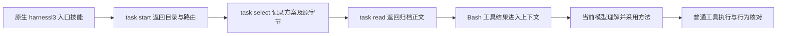

# CLI 返回的技能如何影响后续上下文

2026-11-17；研究工作区 `I:/AI/HarnessL3`，分支 `main`，源码起点 `0045db1`；本机 CLI 0.1.5 / build source `ece5030`。关联 D09/D13/D15、FR05/06/15、TC19/27。本文记录调查与建议，不修改当前 v0.53 产品约定，不代表下述适配已实现。

后续用户已要求恢复 grill-me 并确定待办，当前增补为基准v0.54，见[后续计划与恢复范围](../implementation/SKILL_ADOPTION_PLAN.md)。下文对原会话目录、正文和行为的描述保持调查时事实；方法恢复不追溯改变原任务。

**结论：截图对应的技能正文已完整返回，随后存在符合该方法的两轮真实询问。不能据此认定技能完全未起效，也不能证明行为只由该正文引起。CLI 可以把方法送进模型上下文；后续采用、跨轮保留和遵循程度，需要入口指引、宿主管理与行为验收共同完成。把普通方法编进 CLI 不会自行取得这些能力。**

## 1. 本次会话的实际证据

只读核对截图对应项目、任务与唯一匹配会话，没有启动另一个 agent、自动绑定日志或改写原历史。宿主记录为 Claude Code `2.1.212`，`message.model` 标签为 `deepseek-flash`；标签不证明后端实际提供方，结果不能外推为所有 Claude 模型的效果。

| 定位 | 实际记录 | 能说明什么 |
| --- | --- | --- |
| 原请求，日志 L3 | `/harnessl3  grillme下一步我们做什么` | `grillme` 是 harnessl3 的参数文本 |
| 原生调用，L8 | `Skill`，`skill=harnessl3` | 宿主原生加载的是入口技能 |
| L69 / L3 任务方案 | 选中 `discovery/grilling`，理由是访谈澄清下一步 | L3 选择正确，无独立的当前 `grill-me` 目录项 |
| L72 / L74 | Bash 调用 `task read`，完整返回 `SKILL.md` | 正文进入本次会话的工具结果 |
| L84 | `AskUserQuestion`，3 个问题 | 实际调用宿主询问工具，涵盖状态、资产定位与时间 |
| L85 | 收到第一轮真实回答 | 有回答之后才进入依赖这些答案的分支 |
| L87 / L88 | 根据回答调整方向，再调用 `AskUserQuestion`，3 个问题 | 已观察到按轮继续；第二轮尚无回答 |

原任务 ID 为 `944ace52-eb04-42ae-bdd6-326f7cda37b4`，工作区 ID 为 `05406273-d864-4801-b72e-45948bbcb72a`，技能批次为 `a3e9baf7-f05d-4381-81cc-74da1d965a2b`。`task show` 返回的原方案与会话返回的技能 ID、文件哈希及长度一致。原任务仍开放，本次未关闭或追加其技能读取。

正文为 1549 个 UTF-8 字节，SHA-256 为 `83b915690a95b0632507e7e555fa7b9449d90a8084efae90671ee55888f24e55`。解开工具结果 JSON 后重新编码、计算哈希，与原方案核对通过。截图只展示到 L83 的回复，后面的询问工具调用需要读日志才能确认。

可见回复把方法称为 deck 第 8 页的 `/grill-me`；deck L510、L1083、L1218 确实含有同名介绍和回放。**命名混用了项目材料与所选方法，因果来源无法由措辞判断。** 同时，实际完整返回的方法要求自行查事实、按决策依赖分轮、调用询问工具并等待回答；已观察行为与之吻合。不能把这一吻合进一步写成“已证明模型理解了全部正文”。

另需区别方法版本：[当前 grilling 正文](../../skills/discovery/grilling/SKILL.md)及[升级记录](../../skills/UPSTREAM.md)明确采用独立问题 frontier 分轮，不再要求所有问题逐个单问。三题一轮不是这份正文的失败条件；问题是否真正独立、每题是否都有充分建议与取舍，仍需单独审核。本会话第三题未给明确推荐，不宜评为全部要求通过。

### 证据定位与复核范围

- 原日志：`C:/Users/Bry/.claude/projects/I-------Harness--/a67bb88e-9bf1-496c-aa44-52ed614303f9.jsonl`，244711 字节；只提取用户请求、公开回复和工具调用/结果，不保留思考过程。
- 原日志 SHA-256：`4a4091c9c106217e1b0534e04e9feb1963b76766aec1ebbe8ef801babf4e05d1`，调查前后匹配。
- 读取工具 ID：`call_00_D4mzemcFOldiD8wLTPwa2290`；两轮询问工具 ID：`call_00_7rs7flw4jHwI2Mk8MlSJ0801`、`call_00_71Fwt1gC741W6gkor70F3471`。
- 本机只读脚本 `C:/Users/Bry/AppData/Local/Temp/l3-skill-transcript-check.py` 实跑 PASS：核对原日志指纹、技能内容指纹/长度、唯一原生 Skill 目标、两轮题数以及“返回正文 → 第一轮提问 → 实际答案 → 第二轮提问”的顺序。临时脚本不是产品测试或跨宿主行为评估。

## 2. 当前 L3 到宿主的链路

实现依据：[core/skills.ts](../../core/skills.ts) 的 `scanSkills` / `captureSkills` 扫描文件、记录元数据并冻结所选字节；[core/context.ts](../../core/context.ts) 的 `route` / `readFiles` 分别返回路由与归档正文；[cli/main.ts](../../cli/main.ts) 的 `output` 只向 stdout 写响应。返回值标明 `archived-files-returned; execution-unknown`，没有调用宿主原生 `Skill`、提升消息权限或控制模型执行的方法。

因此需要分别核对四件事：

| 环节 | 可以核对的事实 | 本次状态 |
| --- | --- | --- |
| 选择 | 所选任务、批次、技能 ID | 已核对 |
| 交付 | 实际工具结果包含完整正文及匹配哈希 | 已核对 |
| 采用 | 后续工具/回复满足方法特定要求 | 部分行为已观察，非全部通过 |
| 持续有效 | 多轮、阶段转换和压缩恢复后继续遵循 | 只观察两轮；压缩后未验证 |

`task read` 有名为 `SKILL.md` 的字段，不等于 Claude Code 又执行了一次原生 Skill 加载。普通输出加上 XML 标签、Markdown 标题或“system”字样，也不会自行变成系统消息。这是对当前 stdout 调用边界的判断，并非否认工具返回的方法可以起效。

## 3. 官方机制提供的依据

[Agent Skills 客户端指引](https://agentskills.io/client-implementation/adding-skills-support#step-4-activate-skills)允许用文件读取或专用工具把正文作为工具结果加载；结构包装有助于识别，长期保留需宿主参与。因此，“经 CLI 返回就不能起效”并不成立。包装本身也不保证压缩保护。

[Claude Code Skills](https://code.claude.com/docs/en/skills#skill-content-lifecycle)说明原生调用会将渲染后的正文加入会话，并对压缩后的技能恢复设预算；[动态上下文](https://code.claude.com/docs/en/skills#inject-dynamic-context)允许先执行命令，再把输出内联进原生技能正文。它提供了适配 CLI 内容的入口，但不保证模型每项遵循。

上述为调查日在线文档。本文未在 2.1.212 复验原生动态注入、压缩预算或 Codux 跨模型恢复的保留情况，不把最新文档直接当成本次宿主已通过的测试。现有日志证明的是一次原生 harnessl3 加载和一次 Bash 正文交付。[Claude Code 的 agent 循环说明](https://code.claude.com/docs/en/how-claude-code-works#the-agentic-loop)也将工具结果视作下一步决策的输入。

## 4. 当前确有的缺口

**入口强调“读了再继续”，采用要求不够明确。** [运行时入口](../../agent-skills/harnessl3/SKILL.md)要求先读正文；`route` 又强调技能不是已执行工具、当前 agent 继续标准流程。这些权限与事实边界正确，但没有同样直接地要求把所选方法作为当前阶段的工作办法。此处是可测试的改善假设，不是已经证实的本次失败根因。

**调用者自己截断了响应。** 原会话把 `task start` 输出裁为前 1500 字符，`task select` 裁为 3000 字符，`task read` 裁为 4000 字符，且把 stderr 丢弃。`task start` 完整结果虽存进文件，后续只读了 ID 和字段类型，没有取回路由正文。此次技能短，L74 仍完整；换成长方法，同样的 `[:4000]` 会有正文缺失风险。模型看到的实际 stdout 才是上下文，文件里保存完整响应不足以证明已交付。应使用 CLI 自身的 `--compact` 等可恢复投影，正文不按任意字符数截断，并保留封套和退出码。

**L3 没有控制宿主压缩的能力。** 当前正文在普通 Bash 输出里；L3 的归档能恢复原字节，不能令 Claude 或 Codux 必然保留它。真正丢失时按原任务/批次恢复；不能只保留“用过 grilling”一句摘要，或读取今天的不同版本替换当时正文。

**缺少隔离行为对照。** deck 自带同名方法、用户明确要求 grillme、L3 又返回相近正文，三种信号同时存在。这次只能核对交付和行为吻合，不能归因或统计提升。

## 5. 建议的落地顺序

下列均为建议，尚未修改运行时、CLI 契约或本机用户技能库。普通方法继续可编辑，按实际目录选择、按批次保留字节，符合 D13；编进二进制不能替代宿主适配。

### 第一优先：明确采用所选方法，并核对行为

在运行时入口中补足语义：取得完整正文后，在现有用户授权与项目规则内，将所选方法用于本阶段；提取本阶段需要遵循的动作、等待条件与结束条件，然后开始对应工作。后续轮次继续适用的方法复用，阶段变化仍走已有路由。冲突、正文缺失和工具不可用应如实处理，不把读取当作新授权。

以 grilling 为例，工作状态应包含未决分支、当前可问的问题、已获答案及暂缓项；先核对依赖，再调用宿主询问工具，等待真实答案后更新分支。它可以留在 agent 工作上下文中，无需向产品界面添加工程说明或让用户重复确认已授权动作。

CLI 返回可明确标识 `task / batch / skill / path / hash / content` 及附件读取位置，便于恢复和审核。现有 JSON 已有这些核心定位信息，宜先验证入口改进；不能因为新增 `applied:true` 字段或模型自报就声称执行成功。

### 第二优先：需要宿主保留时，验证一个原生适配入口

可评估一个通用原生方法入口：接收明确的目标、任务、批次和已选技能，通过 CLI 读取该批次归档，再作为原生 Skill 正文交给宿主。动态注入能减少“另读正文被漏掉”的机会；固定归档定位能避免从今天的用户库加载了另一版本。

实现前仍需验证参数引用/跨平台转义、失败/partial、不截断正文、同名覆盖、多方法同时使用及压缩后是否保留实际方法。再次调用原生入口仍可能依赖模型判断；不能宣称这是强制执行。只在正文外放一个继续调用 CLI 的指令，而实际正文仍通过后续 Bash 返回，也不能假定正文已获得原生保留。

不建议把全部普通方法复制注册到宿主目录作为首选：会引入第二套技能目录、同名冲突和当前版本/归档版本漂移。原生入口与用户技能库的任何实际改动另列实施范围。

### 仍需区分的能力边界

确定性的工具拦截与自然语言方法遵循是不同问题。当前 D14 明确不安装 Hook、不启动 agent，本文不建议借调研越过该范围；若未来需要宿主级强制检查，应先讨论产品边界。仅把 CLI 改成 MCP 也不会自动获得原生 Skill 的生命周期或执行保证。

## 6. 后续验收怎么证明“起效”

采用隔离夹具，去掉 deck 中同名介绍，固定正文版本、宿主/模型标签和任务输入。对比：无技能、现有 CLI 正文、补足采用指引后的 CLI 正文，以及可选原生适配。各组输入除待测差异外一致，多次新会话运行，分别记录交付失败与行为失败。

方法中放入与任务相关、又不能仅凭常识猜中的可观察要求；例如特定问题顺序或必要决策项，避免只用“出现 grillme 字样”评成功。grilling 检查：事实自行查找、问题依赖、建议与取舍、真实工具调用、等待真实回答、据答案调整下一轮、分支完成前不越过未获决定。

另测长正文、后续用户消息、同任务换阶段、当前库改变但旧批次保持、上下文丢失后原版本恢复；原生适配须补测实际压缩及当前宿主的跨模型恢复。CLI 字节/Schema 测试通过与真实模型遵循率分别报告。TC19 已有归档测试不能代替 TC27 的宿主行为验收。

本次完成了单会话只读复核、当前代码边界核对及官方机制调研；未执行上述对照、未实施适配、未验证压缩后的持续遵循。
