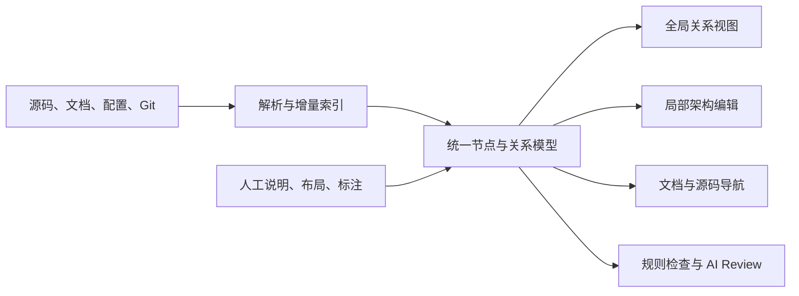

# GitHub 开源项目结构、文档关系、代码架构与 AI Review 方案调研

- 调研日期：2026-11-04。
- 目标：可视化展示项目结构、文档关系、代码框架，同时考察高性能、快速编辑和前端展示能力。
- 范围：43 个工程，涵盖前端编辑器、关系图引擎、架构 DSL、文档图谱、代码分析、AI 架构/PR Review 和自动布局；另列归档工程。
- 本次阶段：调查与能力比较，**不做选型，不确定任何工程为实现参考，不给出性能排名**。
- 核验方式：官方 GitHub README、LICENSE、部分代码/包依赖入口及官方技术文档；未逐项安装部署，也未进行统一性能基准测试。
- 资料时效：许可证、功能和维护状态以本次核验时的版本为准；后续使用需锁定具体版本并重新核对。

## 1. 调研结论

项目结构可视化涉及多个独立层次，通常需要组合实现：

| 层次 | 负责的问题 | 典型交付物 |
| --- | --- | --- |
| 数据抽取 | 从代码、文档、配置中得到哪些对象和关系 | AST、模块依赖、调用关系、文档引用 |
| 统一模型 | 如何关联项目、目录、模块、符号、文档、需求和测试 | 带类型、来源、证据和版本的节点/边 |
| 布局 | 节点放哪里、线怎么走 | 坐标、端口位置、边路由 |
| 渲染与编辑 | 如何浏览、搜索、拖拽、连线、保存和撤销 | 图组件或完整编辑器 |
| 解释与审查 | 如何组织架构、判断违规、分析变更影响 | 架构视图、文档、规则结果、AI Review |

核心判断：

1. **富卡片编辑与大规模关系浏览的技术侧重点不同。** DOM/SVG 方便承载复杂交互，Canvas/WebGL 方便绘制大量图形；两者都需要控制布局、标签、更新和数据规模。
2. **图编辑器不自动提供源码解析。** React Flow、X6 等负责交互表现，代码与文档关系仍需分析器或人工数据。
3. **架构 DSL 不等于业务源码自动分析。** LikeC4、Structurizr 等由统一架构模型生成多个视图，关系主要来自模型描述。
4. **文档关系应区分结构、显式引用与语义关联。** 标题层级、链接关系和“需求由模块实现”需要不同的抽取与维护方式。
5. **AI 生成图需要来源证据。** 概览生成、精确依赖索引、变更影响分析和设计判断不能相互替代。
6. **性能至少拆成索引、布局、渲染、编辑四项。** 不依据演示页面或单一 FPS 指标判断整体性能。
7. **许可证必须按工程和组成部分区分。** GitNexus 当前非商业许可；tldraw 主 SDK 自定义许可；Kodus 混合开源与企业代码许可；商业平台功能不能自动算入开源仓库。

## 2. 前端图形编辑工程（10 个）

这类工程适合拖拽模块、编辑属性、连接端口、组织分组和维护布局。

| 工程 / 许可证 | 可实现效果 | 实现原理与前端接入 | 能力边界 |
| --- | --- | --- | --- |
| [React Flow / Svelte Flow](https://github.com/xyflow/xyflow) · MIT | 模块卡片、端口连线、嵌套分组、缩放、小地图；节点可承载表单与代码摘要 | nodes + edges 数据模型；React/Svelte 组件承载节点，SVG 绘制连线；组件方式嵌入 | 复杂节点的组件更新与 DOM 数量影响性能；自动布局另接布局器 |
| [Vue Flow](https://github.com/bcakmakoglu/vue-flow) · MIT | Vue 3 流程编辑、模块关系图、属性编辑 | Vue 响应式节点与边，自定义节点与连接线，提供状态组合函数 | 面向 Vue 3；大图需控制组件复杂度及更新范围 |
| [AntV X6](https://github.com/antvis/X6) · MIT | 工程化流程图、ER 图、数据血缘、端口式架构图 | HTML/SVG 图编辑引擎；节点、边、端口、事件与插件；可接 React/Vue 等 | 业务属性面板、关系语义与代码解析需自行实现 |
| [LogicFlow](https://github.com/didi/LogicFlow) · Apache-2.0 | 流程设计、审批流、脑图、UML、业务节点与分组 | 图数据、节点模型和视图分离；核心运行时搭配扩展和布局包 | 擅长业务流程定制；代码依赖与文档关系并非自动生成 |
| [JointJS](https://github.com/clientIO/joint) · MPL-2.0 | 端口、路由、分组及结构图编辑 | SVG 渲染，模型与视图分离，提供图遍历、元素与连线 API | Core 与商业 JointJS+ 分开；工具栏、检查器等演示能力可能属于商业部分 |
| [maxGraph](https://github.com/maxGraph/maxGraph) · Apache-2.0 | 分组折叠、泳道、正交连线、撤销重做、传统专业绘图交互 | mxGraph 的 TypeScript 后继；图模型、交互处理、布局与 XML 持久化 | API 体系完整，需要理解较多编辑器概念 |
| [draw.io / diagrams.net](https://github.com/jgraph/drawio) · Apache-2.0，素材另有条款 | 完整架构绘图应用、大量图形库、人工编排 | 完整编辑器应用；官方支持 iframe 和 postMessage 通信 | 更接近嵌入一个产品；业务对象与应用状态的联动需要适配 |
| [Excalidraw](https://github.com/excalidraw/excalidraw) · MIT | 手绘风架构图、讨论白板、文档标注、图文自由组织 | Canvas 白板、场景元素数据、绑定箭头；可通过 React 包嵌入 | 工程关系类型、合法连线和自动分层需要扩展 |
| [Rete.js](https://github.com/retejs/rete) · Core MIT | 可视化编程、数据流水线、输入输出端口工作流 | 编辑器和插件体系；支持数据流、控制流处理，多前端框架接入 | 单纯浏览项目结构不一定需要执行引擎；插件能力和许可另核对 |
| [bpmn-js](https://github.com/bpmn-io/bpmn-js) · bpmn.io 自定义许可 | BPMN 任务、网关、事件、泳道及流程建模 | diagram-js 负责编辑，bpmn-moddle 读写 BPMN XML | 语义围绕 BPMN；许可证要求保留可见的 bpmn.io 标识 |

可实现的产品形态：模块是一张卡片，展开显示职责、文档和接口；模块之间显示依赖；点击节点打开代码或文档。卡片内容、跳转和关系语义由业务应用定义。

补充来源：

- [React Flow 性能文档](https://reactflow.dev/learn/advanced-use/performance)：减少无效重渲染、分离状态、折叠节点树、简化节点与边样式。
- [draw.io 嵌入协议](https://www.drawio.com/docs/reference/embed-mode/)：iframe 与父页面通过 postMessage 交换内容及保存事件。
- [JointJS 与 JointJS+ 许可和产品范围](https://www.jointjs.com/license)。
- [bpmn-js LICENSE](https://github.com/bpmn-io/bpmn-js/blob/develop/LICENSE)：水印保留要求。

## 3. 大规模关系图渲染与探索工程（7 个）

这类工程主要服务于全局地图、邻域展开、聚类、搜索、路径追踪和高亮。

| 工程 / 许可证 | 可实现效果 | 实现原理 | 编辑与性能边界 |
| --- | --- | --- | --- |
| [AntV G6](https://github.com/antvis/G6) · MIT | 网络、树、分组、路径分析、折叠展开、多种布局 | 图模型、布局、交互行为、插件；通过 AntV G 支持不同渲染后端 | 偏关系分析；后端选择、标签和自定义节点会改变性能 |
| [Sigma.js](https://github.com/jacomyal/sigma.js) · MIT | 大型关系网络、搜索、邻居高亮、聚类着色 | WebGL 渲染，Graphology 管理图数据，布局由外部或配套算法计算 | 复杂 HTML 卡片、属性编辑和绘图工具需要补充 |
| [Cytoscape.js](https://github.com/cytoscape/cytoscape.js) · MIT | 复合节点、邻域探索、依赖路径、图算法与关系筛选 | 图论数据模型、选择器、样式系统，配合渲染器与布局扩展 | 边数量、标签、曲线、复合节点都会影响性能 |
| [cosmos.gl](https://github.com/cosmograph-org/cosmos) · MIT | 大规模力导向网络、拖拽缩放、整体群落探索 | 布局与绘制都利用 GPU，通过 WebGL shader 减少 CPU/GPU 往返 | 项目方声明数十万点与连接；不能据此推出同规模复杂卡片编辑性能 |
| [force-graph](https://github.com/vasturiano/force-graph) · MIT | 二维力导向网络、自定义节点、点击和高亮 | Canvas 绘制，d3-force 物理模拟；有 React 绑定和相关 3D 工程 | 持续布局也消耗计算；官方示例的 elements 不应直接理解为节点数 |
| [vis-network](https://github.com/visjs/vis-network) · MIT / Apache-2.0 双许可 | 网络、层次图、聚类、节点增删、基础交互编辑 | Canvas、物理布局、动态 DataSet 和聚类机制 | 官方描述面向数千节点与边的交互，通过聚类处理更大数据 |
| [Apache ECharts](https://github.com/apache/echarts) · Apache-2.0 | 项目树、关系图、矩形树图、旭日图、结构指标仪表盘 | 声明式配置，基于 zrender，支持 Canvas/SVG | 适合展示结构和指标；完整连线编辑器需要另做 |

### 3.1 两个关键区别

- **WebGL 绘图快，不表示布局也在 GPU 计算。** cosmos.gl 将两者放在 GPU；Sigma.js 的渲染与布局分开。
- **拖动节点不等于完整编辑。** 修改关系、校验端口、撤销重做、保存协议和属性编辑是额外能力。

cosmos.gl 的 MIT 引擎与 Cosmograph 产品是不同许可对象，不能混用授权结论。[Cosmograph 产品许可说明](https://next.cosmograph.app/docs-general/citing-and-licensing/)

## 4. 文本维护与架构模型生成工程（5 个）

适合与文档一同版本管理，也便于 AI 生成和批量修改。

| 工程 / 许可证 | 展示效果 | 实现原理与前端方式 | 能力边界 |
| --- | --- | --- | --- |
| [Mermaid](https://github.com/mermaid-js/mermaid) · MIT | 流程、时序、类、状态和架构类视图 | 文本语法解析为图结构，布局后生成 SVG，可在浏览器运行 | 原生编辑是改文本；大图可读性和重新布局成本需控制 |
| [D2](https://github.com/d2lang/d2) · MPL-2.0 | 嵌套架构、组件、网络、时序图 | DSL 编译、布局和路由后输出 SVG 等；核心为 Go，也有浏览器相关实现 | 编译器、布局与编辑产品要分开看；核心不负责扫描代码仓库 |
| [LikeC4](https://github.com/likec4/likec4) · MIT | 总览到组件的逐层探索、跨层关系、多视图架构站点 | 一个架构模型生成多个视图；React 图组件基于 React Flow，布局包含 Graphviz 能力 | 模型源码主要是架构 DSL，不代表自动理解任意业务源代码 |
| [Structurizr](https://github.com/structurizr/structurizr) · Apache-2.0 源码，发行方式另核对 | C4 上下文、容器、组件、部署与动态视图，关联文档和 ADR | DSL 定义统一模型；视图选取模型子集，可本地查看或导出站点 | 源码与预构建 server 产品条款不同；旧 Lite 已归档 |
| [PlantUML](https://github.com/plantuml/plantuml) · 多种许可构建 | UML 类、组件、时序、部署等图形 | 文本解析与布局生成图像/SVG；当前有通过 TeaVM 编译到浏览器的方式 | 核对具体发行包许可；文本生图不自动提供自由拖拽编辑 |

### 4.1 模型与视图分离的机制

模型保存“有什么对象、对象如何关联”，视图保存“本次展示哪些对象”，渲染层负责位置和交互。同一服务可以出现在总览、调用、部署等多个视图，减少关系重复维护。

LikeC4 可核对的实现入口：

- [packages/diagram/package.json](https://github.com/likec4/likec4/blob/main/packages/diagram/package.json)：React Flow 等渲染依赖。
- [packages/layouts/package.json](https://github.com/likec4/likec4/blob/main/packages/layouts/package.json)：Graphviz 等布局依赖。

Structurizr 的源码许可不能代替所有产品发行条款。[local 文档](https://docs.structurizr.com/local)、[server 预构建发行价格与授权说明](https://docs.structurizr.com/server/pricing)

## 5. 文档关系与知识结构工程（3 个）

| 工程 / 许可证 | 展示效果 | 实现原理 | 使用边界 |
| --- | --- | --- | --- |
| [Quartz](https://github.com/jackyzha0/quartz) + [graph 插件](https://github.com/quartz-community/graph) · MIT | 文档局部/全局关系图、标签节点、点击导航 | 构建 ContentIndex；图插件读取链接关系，D3 力导向布局 + PixiJS WebGL 渲染 | 当前 graph 已拆为社区插件；默认展示显式链接，不是语义推理 |
| [Logseq](https://github.com/logseq/logseq) · AGPL-3.0 | 页面与块引用、反向链接、关系导航与白板 | 页面、块及引用组织成可查询结构，再提供图视图 | 完整知识管理应用，嵌入成本高；文件版与 DB 版需区分 |
| [Markmap](https://github.com/markmap/markmap) · MIT | Markdown 标题、列表生成可展开的思维导图 | Markdown 转层级数据，再以 SVG 树形布局和交互呈现 | 适合大纲和项目分解；不适合复杂多对多引用网络 |

### 5.1 文档关系的三种来源

| 关系类型 | 示例 | 数据来源 |
| --- | --- | --- |
| 文档结构 | PRD → 章节 → 子章节 | 文档 AST、Markdown 标题 |
| 显式引用 | 设计文档引用 ADR、README 链接接口文档 | 链接、块引用、元数据 |
| 语义关联 | 需求由哪些模块实现、哪些测试验证 | 人工标注、规则分析、AI 推断 |

Quartz 可参考结构与显式引用的实现；语义关联需要增加抽取方式和证据管理。当前图插件的数据与渲染机制见 [quartz-community/graph](https://github.com/quartz-community/graph) 和 [官方 Graph View 文档](https://quartz.jzhao.xyz/features/graph-view)。

## 6. 代码结构、依赖抽取与架构规则工程（7 个）

| 工程 / 许可证 | 分析与展示效果 | 实现原理 | 准确性与前端边界 |
| --- | --- | --- | --- |
| [dependency-cruiser](https://github.com/sverweij/dependency-cruiser) · MIT | JS/TS 模块依赖、循环、禁止依赖、分层违规 | 解析模块引用，构建依赖图，执行约束；输出 JSON、DOT 等 | 结果可接自有前端；模块依赖不等于完整运行时调用链 |
| [Madge](https://github.com/pahen/madge) · MIT | 模块依赖、循环、孤立模块 | 提取 dependency tree；API 输出对象，Graphviz 输出图 | 别名、语言及模块解析配置会影响结果 |
| [Nx](https://github.com/nrwl/nx) · Core MIT | Monorepo 项目图、任务图、改动影响范围 | 插件构建 Project Graph，再推导任务和 affected 范围 | 已有浏览器图界面；主要是项目/任务粒度，并非函数调用分析 |
| [ArchGuard](https://github.com/archguard/archguard) · MIT | 模块、包、类、方法关系；API 地图、数据库依赖、架构异味 | 扫描与代码分析构建模型，后端 API + 独立前端，执行治理规则 | 语言及框架支持需按分析项核对；README 包含规划项 |
| [CodeCharta](https://github.com/maibornwolff/codecharta) · BSD-3-Clause | 三维代码城市、复杂度与变化热点、依赖和领域语言视图 | 分析器输出统一数据，浏览器提供指标、依赖、版本比较视图 | 偏架构体检和分析；不提供拖拽后自动改源码 |
| [code2flow](https://github.com/scottrogowski/code2flow) · MIT | Python、JS、Ruby、PHP 函数调用图 | AST 提取定义与调用，启发式匹配，Graphviz 输出 | 官方明确为近似调用图；动态语言、反射等存在歧义 |
| [ArchUnit](https://github.com/TNG/ArchUnit) · Apache-2.0 | Java 分层、包依赖、循环和架构规则检查 | 导入字节码，建立类与依赖模型，使用测试断言检查 | 无完整图编辑前端；可提供 CI 与图上违规标记数据 |

补充入口：[ArchGuard 独立前端](https://github.com/archguard/archguard-frontend)。

图上修改通常不等于代码修改。删除可视化中的 import 边，只有在源码也被修改并验证后，才真正改变代码依赖。

## 7. AI 架构、代码知识与 PR Review 工程（7 个）

| 工程 / 许可证 | 实现效果 | 核心原理 | 可复用范围与限制 |
| --- | --- | --- | --- |
| [CodeBoarding](https://github.com/CodeBoarding/CodeBoarding) · MIT 引擎/CLI | 分层架构地图、组件展开、源码定位、PR 组件与依赖变化 | 静态分析提取关系，模型组织组件名和职责；输出 analysis.json，支持增量和局部分析 | 开源范围是分析引擎与 CLI，不能自动将在线平台完整前端算入同一仓库 |
| [GitDiagram](https://github.com/ahmedkhaleel2004/gitdiagram) · MIT | 仓库生成架构概览、组件跳转源码、导出 Mermaid/PNG | AI 生成架构解释与 Mermaid，前端渲染及链接交互 | 用于可阅读概览；抽象和关系需核验，不代替精确依赖索引 |
| [DeepWiki-Open](https://github.com/AsyncFuncAI/deepwiki-open) · MIT | 代码 Wiki、架构与数据流图、仓库问答 | 仓库分析、代码嵌入和检索、模型生成文档、Mermaid 展示 | 文档 + 图 + 问答应用；当前主 README 已转向 2.0/Grok-Wiki，部署需对应版本 |
| [CodeGraphContext](https://github.com/CodeGraphContext/CodeGraphContext) · MIT | 调用者、继承、导入、复杂度、潜在死代码查询与交互图 | Tree-sitter / 可选 SCIP 索引构建代码图，图数据库存储，CLI/MCP 查询，文件监听 | --viz 提供浏览器图；准确性取决于语言与索引方式 |
| [RepoGraph](https://github.com/ozyyshr/RepoGraph) · Apache-2.0 | 为 AI 提供定义、引用与仓库级结构上下文 | 细粒度代码图、NetworkX 存储检索，接入 SWE-agent、Agentless | 研究与算法参考；缺完整前端，README 提示构图可能较慢 |
| [PR-Agent](https://github.com/The-PR-Agent/pr-agent) · 当前 MIT | PR 总结、审查、建议、改动问答 | 获取 diff 和上下文、压缩输入、模型生成结构化结果；CLI/CI/Webhook | 社区维护，并非架构图产品；不包含 Qodo 商业产品全部能力 |
| [Kodus](https://github.com/kodustech/kodus-ai) · AGPL + 企业代码混合 | PR Review、自然语言规则、问题跟踪、面板与 CLI | 改动上下文、团队规则和模型结合；规则可表达架构约定 | .ee. 文件及 ee/ 目录为企业许可，不能把整个产品视作纯 AGPL |

### 7.1 三种 AI 架构实现路线

- **概览生成**：GitDiagram 重点是快速得到可阅读的架构解释与图形。
- **结构证据 + AI**：CodeBoarding、CodeGraphContext 先建立代码结构，再用于组织架构、追踪关系和提供上下文。
- **代码知识入口**：DeepWiki-Open 将文档、图形、检索和问答组织在一起。

CodeBoarding 的架构比较需要基线，PR 查看也需要已有分析结果；并非打开任意 diff 就自动得到完整架构比较。其开源数据输出、增量分析与平台范围见 [README](https://github.com/CodeBoarding/CodeBoarding)。

DeepWiki-Open 的 RAG 和 Mermaid 机制另见 [中文文档](https://github.com/AsyncFuncAI/deepwiki-open/blob/main/README.zh.md) 与 [API 文档](https://github.com/AsyncFuncAI/deepwiki-open/blob/main/api/README.md)；不同语言文档与新版本入口应结合具体代码版本核对。

### 7.2 AI Review 与架构审查的层次

| 审查层次 | 回答的问题 | 工程方向 |
| --- | --- | --- |
| 确定性规则 | 是否循环依赖、是否违反分层 | dependency-cruiser、ArchUnit、ArchGuard |
| 结构影响 | 修改接口会影响哪些调用者、模块 | CodeGraphContext、CodeBoarding 等 |
| 设计判断 | 职责、耦合和抽象是否合理 | 带架构上下文的模型分析、Kodus 规则、PR-Agent 定制 |

设计判断需要业务约束和设计意图，不能仅靠结构图得到确定答案。模型推断与静态分析事实应在数据中明确区分。

## 8. 自动布局工程（2 个）

| 工程 / 许可证 | 效果与原理 | 接入与边界 |
| --- | --- | --- |
| [ELK.js](https://github.com/kieler/elkjs) · EPL-2.0 | 分层、嵌套、端口约束、边路由等工程图布局 | 输入图，返回坐标与路由；支持 Web Worker，不负责绘制、样式、编辑 |
| [Dagre](https://github.com/dagrejs/dagre) · MIT | 将有向图组织成层次布局 | 输入节点尺寸和连线，输出位置；当前维护包是 @dagrejs/dagre，不含完整图界面 |

ELK.js 的 Worker 将计算移出 UI 主线程，减少界面冻结；这改善响应性，不表示布局总耗时一定缩短。

## 9. 源码可见但许可受限工程（2 个）

| 工程 | 效果与原理 | 当前许可与边界 |
| --- | --- | --- |
| [GitNexus](https://github.com/abhigyanpatwari/GitNexus) | 符号、调用、依赖、执行流程知识图；Web 浏览、MCP、影响分析和改动检测；使用 Tree-sitter、嵌入式图数据库、Sigma.js 等 | 当前 PolyForm Noncommercial 1.0.0，商业使用另行授权；不能沿用旧资料认定为宽松许可 |
| [tldraw](https://github.com/tldraw/tldraw) | React 无限画布、自定义形状/工具/绑定、内容嵌入、AI 画布交互；采用 DOM 画布等机制 | 主 SDK 当前为 tldraw 自定义许可，生产使用涉及许可条件；Starter Kit 的 MIT 不代表主 SDK 也是 MIT |

关键许可来源：

- [GitNexus LICENSE](https://github.com/abhigyanpatwari/GitNexus/blob/main/LICENSE)。
- [tldraw LICENSE.md](https://github.com/tldraw/tldraw/blob/main/LICENSE.md)。
- [Kodus license.md](https://github.com/kodustech/kodus-ai/blob/main/license.md)：区分 AGPL 和企业代码；部分 Community 功能可以使用未修改企业代码运行，不表示允许任意修改企业代码。
- [PR-Agent LICENSE](https://github.com/The-PR-Agent/pr-agent/blob/main/LICENSE)：当前 MIT；旧介绍可能不对应当前仓库与许可。

## 10. 已归档工程与维护状态变化

| 工程 | 本次核验状态 | 调研中的定位 |
| --- | --- | --- |
| [mxGraph](https://github.com/jgraph/mxgraph) | 2021 年归档 | 历史 API、交互体系参考；maxGraph 延续该技术体系 |
| [Sourcetrail](https://github.com/CoatiSoftware/Sourcetrail) | 2021 年归档 | 代码图与源码联动的交互参考 |
| [Structurizr Lite](https://github.com/structurizr/lite) | 已归档，官方要求迁移 | 应调查整合后的 Structurizr 工具，而非将旧 Lite 当成持续维护入口 |

维护状态说明只针对已核验的具体变化；本报告没有为每个工程提供统一的提交活跃度、发行频率或维护 SLA 评级。

## 11. 高性能与快速编辑的工程判断

本节是依据实现机制的综合分析，不是统一实测结果。

### 11.1 四类性能指标

| 指标 | 衡量的问题 | 常见成本 |
| --- | --- | --- |
| 索引速度 | 代码/文档修改后多久更新关系 | 全量扫描、语义解析、跨文件解析、增量失效范围 |
| 布局速度 | 展开或增删对象后多久重新排列 | 图密度、嵌套、端口约束、路由、全图重排 |
| 渲染速度 | 缩放、平移、搜索、高亮是否流畅 | 节点/边/标签数量、样式、绘制与组件更新 |
| 编辑延迟 | 输入、拖动、连线、撤销是否即时 | 状态传播、同步计算、持久化、每次操作触发重排 |

一个引擎可以绘图很快，但编辑时不断触发全图布局；一个编辑器也可以交互流畅，但源码索引更新很慢。FPS 无法独立反映整体体验。

### 11.2 渲染机制的取舍

| 机制 | 适合的表现 | 需要控制的成本 |
| --- | --- | --- |
| DOM / SVG | 富卡片、表单、文字编辑、端口、复杂节点 | 元素数量、组件更新、文本测量、样式与布局 |
| Canvas | 密集图形、统一节点、定制绘制 | 命中检测、输入控件、无障碍、编辑工具 |
| WebGL | 大量简单节点与边、全局关系探索 | 标签、GPU 数据更新、富卡片和编辑界面 |
| 预生成 SVG/图片 | 文档、分享、版本留档、只读图 | 再生成成本、可编辑状态保存 |

无论采用哪种渲染器，分层、聚合、过滤、按需展开与局部更新都会影响可读性和性能，不能只依赖更换渲染后端。

### 11.3 共用数据模型的界面分工

以下是解释工程分工的概念结构，没有预设具体技术选型：

统一数据中至少区分：

- 对象：项目、目录、文件、模块、符号、文档、需求、测试。
- 关系：包含、导入、调用、继承、引用、实现、验证。
- 来源：解析事实、人工维护、AI 推断。
- 证据与版本：源文件、位置、commit、更新时间；必要时保留置信度和歧义。

这样“文档引用模块”和“函数调用函数”不会混为同一类线，AI 推断也可以与代码事实分开显示。

### 11.4 三类编辑对象

| 编辑内容 | 所属层 | 生效机制 |
| --- | --- | --- |
| 位置、颜色、分组、注释 | 视图 | 保存布局与展示状态 |
| 需求由模块实现、文档解释接口 | 知识模型 | 保存语义关系及来源 |
| 删除 import、重构模块、改函数调用 | 源码 | 修改代码、检查差异、执行验证、刷新索引 |

三类编辑可在同一界面提供，但应保持清晰的保存和生效机制。

### 11.5 后续可采用的统一验证方式

测试档位可设置为 1,000 / 10,000 / 50,000 节点，并固定边密度、标签比例和嵌套深度。这些是拟定测试档位，**不是本次已验证的项目能力**。

统一记录：

1. 首次加载和首次布局耗时。
2. 展开子图、增删节点、批量更新耗时。
3. 平移缩放、拖拽、文字输入和连线响应。
4. 搜索、上下游高亮、路径查询耗时。
5. 内存占用、后台计算是否阻塞 UI。
6. 源码改动后的增量更新耗时和正确性。
7. 保存、恢复、撤销重做与版本对比行为。

测试需注明浏览器、硬件、渲染后端、布局参数和节点样式，区分简单圆点图与包含表单/代码的复杂卡片图。

## 12. 调研边界与未决事项

- 未选定参考工程，也未为后续实现锁定前端框架、数据模型或解析技术。
- 未逐项验证安装成功率、构建体积、无障碍、多人协作、离线运行和部署成本。
- 未做统一性能基准、源码解析准确率测试或 AI Review 质量评测。
- 官方大图规模声明不构成对目标场景的性能保证；运行时调用、动态导入、反射等也可能超出静态分析覆盖范围。
- 许可证记录用于区分本次调查对象，实际集成需针对所用版本、插件、素材、发行包及企业代码重新核对。
- 表中 43 个工程按主仓库去重计数；Quartz graph 为 Quartz 实现的补充入口，React Flow/Svelte Flow 按同一 xyflow 仓库计数；归档项另列，不计入 43 个主体工程。

本报告保留组件库、完整应用、分析引擎、研究实现和布局器各自的参考价值；当前状态为调研完成、选型未进行。
