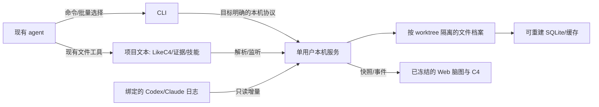

# 架构与工程边界

v0.39观察路径：Web的只读视图读取已记录模型/任务/最近状态，日常增量观测与严格来源核验独立调度；浏览不启动完整源码采集。sourceObservation不是可供任务绑定的完整来源，所有严格提交边界保持现有检查。耗时采集共享在途工作并合并通知，派生索引按连续提交事务追赶。

规格v1.0，实现及平台验证见[实施状态](../implementation/STATUS.md)。目标与约束：[基准](../PROJECT_BASELINE.md)；公开协议：[CLI契约](cli-contract.md)。

## 工具链

- CLI/核心服务统一TypeScript ESM，npm包导出`harnessl3`二进制入口；普通技能作为独立文件随包分发。
- 正式首条支持线为Node.js 24 LTS，最低24.12.0；每次验收记录实际patch版本。正式包engines与.nvmrc按此限定，当前原型的Node>=22.22.3不是正式支持承诺；平台验证使用隔离环境。
- Web沿用React/TypeScript/Vite与自实现SVG画布，LikeC4先固定仓库现有1.60.0作为提取起点，升级须单独验证解析/布局/历史兼容。
- 程序/契约/CLI进程测试用Node内置测试，Web用Playwright；三平台CI使用各自原生文件系统和Git worktree夹具。
- SQLite采用`node:sqlite`隔离在worker内的适配层，只处理派生索引。当前Node24.12模块仍属活跃开发，必须在M1验证加载/FTS/重建/worker错误传播；不能称其API已稳定或绕过支持版本门禁。依据见[存储规格](storage.md)。

## 进程与数据流

CLI是参数/协议/展示适配层，核心用例只实现一份。服务在用户首次需要状态/监听时自动启动，后续CLI复用；只绑定127.0.0.1，端口由系统分配，不能假设4317可用。用户数据根中的服务描述记录PID、启动身份、端点、协议版本和CLI连接凭据。本机服务以连接稳定性、自动恢复和数据完整性优先：普通命令读取定位后直接发送认证RPC，不要求先通过独立健康检查；服务在执行业务前核对客户端提供的协议、实例和数据根。新增身份请求头可选以兼容既有协议1客户端；既有本地凭据校验保留，CLI无用户登录步骤。

健康检查用于状态查询和启动诊断，区分running、draining、unavailable与conflict；PID只作恢复线索，超时、连接失败或排空不得推断为身份冲突。暂时失败有界等待并重读定位；实例/凭据/端点已更新则连接当前记录。普通RPC只自动重试确认尚未执行的连接拒绝或业务分派前的HTTP拒绝，保持原requestId；响应丢失、损坏或提交结果未知时返回诊断，先核对回执，不自动重发业务写请求。确认旧进程退出且端点连接拒绝后，可按原单实例启动流程恢复；未知存活进程不强杀、不因超时并起第二个写实例。超时与重试参数是内部实现默认值，不是性能SLA。

默认用户数据根是同一操作系统用户的全局单实例，全部项目、worktree和任务复用；没有空闲退出时限，停止/进程退出/关机后结束。显式隔离的数据根可并行，用于测试或独立实例，不能共享活动档案。内部按worktree建立独立模型、监听器、写队列、归档和索引worker。跨目标请求可并发，同一目标提交串行；Web选中项目不改变服务身份或Git检出。

服务启动采用锁文件的排他创建和有界重试，启动失败清理自己创建的描述，不接管未知进程。Windows后台启动隐藏窗口；支持显式前台模式用于诊断。`serve stop`先停止接收新写请求并等待已接受请求落盘，不能删除历史。恢复只以有效commit为提交依据：无commit可用同requestId重试，有commit回放原结果；已存旧记录确实无法判定时才标unknown，不把所有进程中断都变成永久未知。

描述尚未发布而存在活启动锁时，状态为`unavailable`，原因`startup-in-progress`，可返回锁中PID/实例ID/开始时间用于诊断；这不是端点身份认证。`serve start`有界等待同一所有者，不额外spawn竞争者；尚无可认证停止端点时`serve stop`返回BUSY，不伪报已停止，不用PID强杀。失效锁、文件异常及身份冲突继续按原保护边界处理。

路径隔离预检在监听前完成，控制端点随后发布；档案和显式订阅在后台恢复，健康结果分别报告running与recovery进度/失败，不把控制运行当作全部工作区已核验。目标业务请求仍等待对应完整档案和用例资源，未验证状态不能提前当作空历史。解析长journal时分段让出事件循环；关闭等待在途恢复，恢复期间拒绝GC apply，显式订阅恢复与登记变更串行。

每个Runtime对同一worktree共享一份已验证Archive及加载Promise，启动订阅恢复、任务资源与普通legacy列表复用；显式迁移检查/所请求旧档案的字节核对仍保留。类型/任务定位由有效提交派生，不能暴露可变内部记录或省略损坏检查。服务描述可附构建来源和运行文件指纹；旧协议1客户端/服务未带此字段仍可按原RPC契约通信，安装验证单独核对实际服务构建，不把构建指纹变成普通RPC新的探活门槛。

浏览器由web open显式打开，--no-open只取真实登录链接。实际上下文和必要技能正文返回当前agent后，取得链接，在进度消息中展示一次“查看HarnessL3的输出”Markdown引用卡片，再继续用户工作，最终答复不重复；格式见运行时skill。不附使用/选择说明、裸地址或常规到期文案，CLI不接管宿主TUI渲染。一次登录码5分钟/一次性、成功浏览会话12小时，与常驻服务的寿命分开；服务身份和登录期限分别返回。重复链接可复用有效浏览会话，但不轮换cookie或续期；无有效会话仍需新码，401为认证错误。CLI不要求浏览器在线，Web失败不阻断可用CLI。Web资源随包分发，HTTP API只接受本机合法同源请求；CLI私有连接凭据不输出，URL目标仍须核对归属。

项目初始化的语义部分由当前大模型通过已有文件工具完成：阅读真实项目、维护LikeC4对象/层次/关系与证据、报告进度、校验结构和披露覆盖缺口。CLI只建立机械脚手架、登记、保存/解析/投影，不调用额外模型或用目录生成脚本推断业务语义；init返回scaffold-ready且语义not-assessed，避免机械成功被当作知识完成。

## 模块职责

| 模块 | 输入与产出 | 边界 |
| --- | --- | --- |
| workspace | Git路径/项目配置→项目、worktree身份与机器注册 | 只登记已有目录，不执行Git创建/切换/删除 |
| model | LikeC4/证据/别名→有效快照、简述、诊断、C4 | 文本为权威，缓存不回写成第二套模型 |
| references | 本地文档证据→批量Git归属诊断 | 只读索引/ignore，不暂存、不改来源策略或复制文档 |
| context | 任务/批量查询/选择→精确上下文与交接 | 复用模型快照，不调用LLM |
| skills | 实际目录→轻目录/诊断/指纹；所选文件→归档引用 | 不替agent选择，不执行脚本 |
| archive | 日志/事务提交→任务、快照、技能字节、历史视图 | 历史不可由当前内容补造 |
| index | 归档/解析结果→可重建查询索引 | SQLite失效不能导致静默丢失历史 |
| observation | 明确绑定的两类日志→规范化事件/覆盖报告 | 只读，不安装Hooks、不执行日志代码 |
| freshness | 源码/显式引用变更及proof→待核验/核验记录 | 保留有效模型证据诊断，按范围阻止失效依据被清除；机械校验不等于语义证明 |
| presentation | 公共用例→CLI文本/JSON、Web快照与事件 | 视图展开不产生agent读取记录 |

## 项目与本机目录

Git内默认约定是`.harness/project.json`、`.harness/model/*.c4`、`.harness/evidence.json`、`.harness/aliases.json`；目录/相对模型位置由配置契约限定。项目UUID随Git保存；worktree UUID在本机注册，绑定真实目录与Git common-dir，不能用分支名、远端URL或模型hash替代。

机器数据根由`--data-dir`、`HARNESSL3_HOME`、各平台默认数据目录依次解析，具体布局见[存储](storage.md)。数据根必须在所有登记worktree之外，不能等于或作为worktree的祖先；新登记冲突时拒绝，不能隐式移动或改绑数据。绝对路径、端口、日志位置与运行事件不写Git配置。路径比较用规范化真实路径：Windows按文件系统大小写规则，POSIX保留大小写；拒绝跨目标的符号链接逃逸。

初次`init`只在不存在的全局用户技能根复制随包20方法、附件与MIT；已有目录（包括空库）不覆盖、不自动合并。项目可指定相对技能根，机器环境可覆盖；目录解析优先级以[模型与技能规格](model-context.md)为准。技能根不能等于worktree根或与Git/模型/运行档案重叠；专用dataRoot/skills作为用户内容允许。项目内解析后的技能根固定排除源码扫描并进入扫描策略指纹，技能编辑只更新目录版本。用户技能根不是缓存，GC不能删除。包升级不自动覆盖用户编辑。

## 原型复用与迁移

取消登记后保留原registry身份与档案。明确指定inactive worktree UUID仍可访问history list/show、task show/handoff/read；归档读取不要求当前目录/HEAD仍存在，但要核对原归属和档案完整性。新query/select/prompt/sync等活动操作不能借此使用停用目标，当前源码预览也不能伪装为历史。

| 现有资产 | 正式实现处理 |
| --- | --- |
| context-reader / task-history / atomic-file与测试 | 提取用例与事务/历史经验，替换硬编码和未版本化边界 |
| skill-library / skill-hub-watch / skill-hub | 保留实际文件扫描、引用和版本校验语义，使用正式目标/存储接口 |
| context-map / canvas / skill-layout与Slate | 保留最终交互，改接正式只读投影，不重新选版 |
| server/index、config与scripts命令 | 拆除MGRP、仓库绝对位置、固定端口和全局最新日志假设 |
| agent-log | 拆成两类版本适配器与覆盖报告；现有部分解析不能作为双agent验收 |
| examples/mgrp与旧本机档案 | 示例/兼容输入；显式复制导入，原件不覆盖 |

准备阶段已完成。当前正式工程在core/cli/service/web逐用例实施，src/server与旧scripts/tests保留作原型参考；共享入口/package由主代理统一维护，避免混用原型机器路径和正式运行数据。
